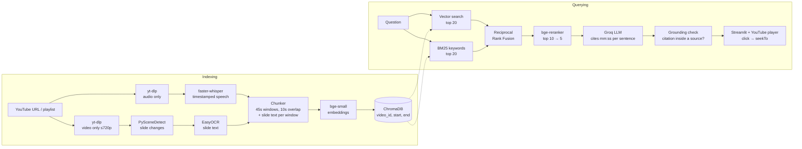

# Video RAG – Jump to the Moment

Ask a question about a lecture video, get an answer where every claim cites a timestamp
like **[17:33]**, and click it to play the video from that exact second.

**Live demo:** _coming soon (Hugging Face Spaces)_ · Stack: faster-whisper · PySceneDetect + EasyOCR ·
bge-small + BM25 + RRF · bge-reranker · ChromaDB · Groq · Streamlit · FastAPI · Docker

<!-- Demo GIF: record the app, save as docs/demo.gif, then uncomment the next line -->
<!--  -->

## Results

50 hand-labelled questions over 4 lectures (104 chunks). A retrieved chunk counts as correct if it's from the
right video and the ground-truth moment lies inside it (±20s). Every query searches **all** videos at once.
Each row adds one component to the row above ([eval/evaluate.py](eval/evaluate.py), [raw results](eval/results.md)).

| Setup | Hit@1 | Hit@3 | Hit@5 | MRR | Latency/query (CPU) |
|---|---|---|---|---|---|
| transcript-only (vector) | 0.40 | 0.80 | 0.88 | 0.610 | 0.04s |
| + slide OCR | 0.48 | 0.84 | 0.92 | 0.670 | 0.04s |
| + hybrid (BM25 + RRF) | 0.54 | 0.90 | **1.00** | 0.733 | 0.04s |
| + cross-encoder reranker | **0.66** | 0.88 | 0.98 | **0.790** | ~8-10s |

Hit@1 by question type — where each component helps:

| Setup | keyword (15) | paraphrase (26) | slide-only term (9) |
|---|---|---|---|
| transcript-only | 0.53 | 0.35 | 0.33 |
| + slide OCR | 0.53 | 0.42 | 0.56 |
| + hybrid | 0.53 | 0.42 | **0.89** |
| + reranker | **0.73** | **0.54** | **0.89** |

**End to end** (final setup + gpt-oss-120b): 92% of answers cite at least one timestamp within ±20s of the
right moment (90% for the first citation), 2% answered "not found", **0 hallucinated timestamps**.

What the numbers say:
- **Slide OCR** matters most where Whisper mishears jargon: it transcribed "Heaps' law" as *"keep slow"*,
  "Zipf's law" as *"zip slot"*, "RAG-Fusion" as *"rag views"*. The slides spell them correctly.
- **BM25** then turns those exact on-screen terms into hits (slide questions 0.56 → 0.89); vectors alone
  blur rare words like "Zipf" into generic meaning.
- **The reranker** gives the biggest jump in Hit@1 (+12 points) by reading question and chunk together,
  at the cost of ~8s per query on CPU.
- **An eval-driven fix:** to save time I first cut reranker input to 320 tokens. The per-type table
  showed slide questions *dropping* (0.89 → 0.67): slide text comes after the speech and was being
  truncated away. 512 tokens restored it (Hit@1 0.60 → 0.66). Putting slide text first at 320 tokens
  did not fix it (0.62).

Where it still fails (Hit@1 misses):
- **Recaps across videos**: chapter 2 recaps chapter 1 ("784 neurons", "13,000 weights"), so searching
  all videos often returns the recap. That's arguably a useful answer, but it's scored as wrong.
- **Strict ground truth**: e.g. "What is Boolean retrieval?" was answered from a later slide titled
  "Boolean query: exact match" — reasonable, but not the labelled moment.
- **Over-cautious LLM**: "What is RAG-Fusion?" got "not found" although the slide names it
  (see `LLM_REASONING_EFFORT` below).

Caveats: 50 questions is small (one question = 2 points of Hit@1); questions were written by reading the
transcripts and slides, which may favour wording that appears in them (mitigated by 26 paraphrased
questions); latency was measured on an 8 GB laptop CPU.

## How it works



Two downloads instead of one: Whisper only needs audio and OCR only needs pictures, so the streams are
never merged and ffmpeg isn't needed. The LLM sees each transcript line and each slide with its own
`[mm:ss]`, so citations point to a sentence, not a 45-second chunk.

## Setup (Windows, CPU only)

```powershell
cd "C:\Users\aparn\Documents\video rag"
python -m venv .venv
.\.venv\Scripts\Activate.ps1
pip install torch torchvision --index-url https://download.pytorch.org/whl/cpu   # CPU-only, much smaller
pip install -r requirements.txt
copy .env.example .env   # then put your Groq key (console.groq.com/keys) in .env
```

Node.js (or Deno) must be installed: yt-dlp uses it to solve YouTube's JS challenge.
No ffmpeg needed: audio and video are downloaded as separate streams and never merged.

## Usage

**Web UI**
```powershell
streamlit run ui/streamlit_app.py
```
Add a YouTube video or playlist in the sidebar, ask a question, click any timestamp.

**CLI**
```powershell
python -m app.cli index "https://www.youtube.com/watch?v=JChPi0CRnDY"            # with slide OCR
python -m app.cli index "https://www.youtube.com/playlist?list=..." --no-slides  # whole playlist, speech only
python -m app.cli ask "what are the general approaches to transform questions?"
python -m app.cli search "what is ReLU?" -k 5                                   # retrieval only, no LLM
python -m app.cli search "what is ReLU?" --no-hybrid --no-rerank                # plain vector search
python -m app.cli list
```

**REST API**
```powershell
uvicorn app.api:app --reload      # docs at http://127.0.0.1:8000/docs
```
`GET /videos`, `POST /index {"source": url, "slides": true}`,
`POST /ask {"question": "...", "video_id": null, "hybrid": true, "rerank": true}`

**Evaluation**
```powershell
python -m eval.evaluate              # 4 retrieval setups, ~10 min on CPU (reranker is the slow part)
python -m eval.evaluate --answers    # + check the LLM's citations (50 Groq calls)
```
Questions live in `eval/test_questions.json`: `{"question", "video_id", "timestamps": ["mm:ss"], "type"}`.

**Tests**
```powershell
pytest
```

## Project layout

```
app/ingest/      downloader (audio, video, playlists), transcriber, frames (scenes + OCR), chunker
app/retrieval/   embedder, vector_store, hybrid_search (BM25 + RRF), reranker (cross-encoder)
app/generation/  answer.py: prompt, Groq call, citation parsing + grounding check
app/pipeline.py  index_video(), index_source(), search(), ask()
app/cli.py       command-line entry point
app/api.py       FastAPI backend
app/seed.py      export / rebuild the pre-indexed demo videos (demo_data/)
deploy/          Hugging Face Spaces upload script + Space README
demo_data/       transcripts, chunks, slide text of the 4 demo lectures (committed, ~340 KB)
ui/              Streamlit app (player + clickable answer in one component)
tests/           unit tests (chunker, citations, OCR helpers, RRF, BM25 tokenizer, eval metrics)
eval/            50 labelled questions, evaluate.py (Hit@k, MRR, citation accuracy), results
data/            downloads, transcripts, frames, vector DB (gitignored)
```

## Key design choices

**Indexing**
- **Audio-only + video-only downloads**: Whisper needs only audio, OCR needs only pictures, so we never
  merge streams and never need ffmpeg.
- **Whisper `base`, int8 on CPU**: good accuracy/speed trade-off; transcripts cached so re-indexing is instant.
- **45s chunks, 10s overlap, cut on segment boundaries**: long enough to hold one idea, short enough
  that a hit points to a precise moment; the overlap keeps answers that straddle a boundary retrievable.
- **bge-small-en-v1.5**: small (384-dim), fast on CPU, strong on retrieval benchmarks.

**Slides (OCR)**
- **Scene detection on brightness + edges, not colour**: when a slide changes, colours barely move but
  text (= edges) does. The default colour-based detector found 2 scenes in our test lecture; edges found 20.
- **Resample long scenes every 45s** to catch slide builds and fades the detector misses.
- **Skip OCR on unchanged frames** (tiny thumbnail diff) and **merge near-identical consecutive slides**
  (text similarity ≥ 0.85): OCR costs ~6-9s per frame on CPU.
- **Ignore the top 5% of the frame**: removes OS menu bars / browser tabs in screen recordings.
- Slide text is embedded and keyword-indexed with the speech, and shown to the LLM as
  `[mm:ss] (on screen) ...` lines it can cite. In our test video, "RAG-Fusion" and "Step-back"
  appear only on slides: without OCR they were unsearchable.

**Retrieval**
- **Hybrid = vector + BM25, fused with Reciprocal Rank Fusion** (`1/(60+rank)`): vectors handle
  paraphrases, BM25 handles exact rare terms ("ReLU", "HNSW"). RRF uses ranks only, so the two
  incompatible score scales never need normalising.
- **Cross-encoder reranking** (bge-reranker-base): reads question and chunk together, so it is more
  accurate than comparing separate embeddings. Example: for "what is ReLU?" plain vector search put
  two unrelated chunks at #2-#3; after reranking, the top two are both the ReLU discussion.
- **Rerank only the top 10, at 512 tokens**: ~1s per pair on CPU, so reranking all 20 candidates took
  ~20s. Top 10 halves that; 512 (not 320) tokens so slide text isn't truncated (see Results).

**Answering**
- **Retrieve by chunk, cite by sentence**: the LLM sees each transcript line with its own timestamp.
- **Grounding check**: every cited timestamp must fall inside a retrieved source (±5s); otherwise it's
  shown struck-through in red as a likely hallucination.
- **Player + answer in one HTML component**: clicking a timestamp seeks the player in the browser,
  without a Streamlit rerun. Citations from another video switch videos.

## Deployment

**Docker** (CPU-only image, query models baked in, serves the UI on port 7860):
```powershell
docker build -t video-rag .
docker run -p 7860:7860 -e GROQ_API_KEY=your_key video-rag     # open http://localhost:7860
```

**Hosted demo (Streamlit Community Cloud, free)**: YouTube blocks most downloads from cloud servers, so
the hosted demo is *question-answering only* over the 4 evaluated lectures. `demo_data/` holds their
transcripts, chunks and slide text (~340 KB of JSON); on first start the app rebuilds the vector index
from it in seconds (`app/seed.py`). The host installs the slim `ui/requirements.txt` (CPU torch, no
Whisper/OCR). Measured memory: ~0.7 GB without the reranker, ~1.9 GB with it (limit 2.7 GB).

1. share.streamlit.io → *Create app* → repo `video-rag`, branch `main`, file `ui/streamlit_app.py`
2. *Advanced settings*: Python 3.13; Secrets:
   ```toml
   GROQ_API_KEY = "your_key"
   HOSTED_DEMO = "true"
   ```

Optional environment/secret overrides: `USE_RERANKER=false` (≈8s faster per query, ~1.2 GB less RAM),
`USE_HYBRID`, `ENABLE_SLIDES`, `LLM_MODEL`, `LLM_REASONING_EFFORT`.

**Hugging Face Spaces (Docker)**: `python -m deploy.deploy_hf YOUR_HF_USERNAME` uploads the Docker app,
but Docker Spaces now need a PRO subscription, so the free demo uses Streamlit Cloud instead.

To add your own videos to the shipped demo: index them locally, add their ids to `DEMO_VIDEOS` in
`app/seed.py`, run `python -m app.seed --export`, commit `demo_data/`.

## Known limitations
- The hosted demo can't reliably index new YouTube videos (cloud IPs are blocked); run locally for that.
- Reranking costs ~8-10s per query on a laptop CPU (free Spaces hardware is similar).
- OCR on CPU is slow (~4 min for a 6-min screen-recorded lecture); use `--no-slides` for talking-head videos.
- Screen recordings produce noisy OCR (notebook UI, menus). It's indexed anyway; the reranker and LLM cope.
- gpt-oss at low reasoning effort sometimes answers "not found" when sources only partly cover a
  question (`LLM_REASONING_EFFORT=medium` in `.env` is more thorough but slower).
